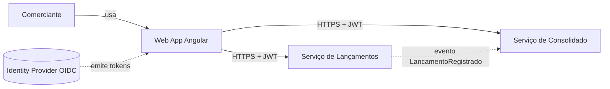
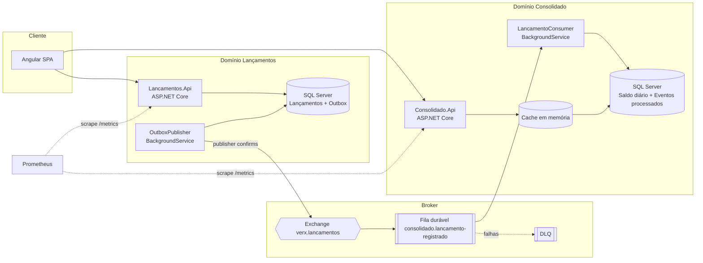
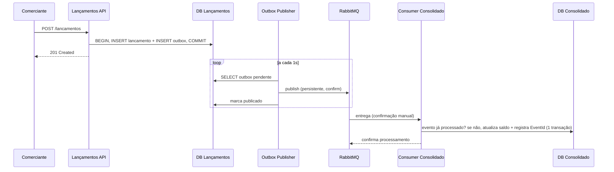

# Desenho da solução

Este documento descreve a arquitetura alvo para atender aos requisitos de [001-requisitos.md](001-requisitos.md), nos domínios definidos em [002-dominios.md](002-dominios.md).

## 1. Diagramas

Os diagramas das seções 2, 3 e 4 estão em Mermaid neste documento e também em uma versão editável no draw.io:

[diagramas/arquitetura-alvo.drawio](diagramas/arquitetura-alvo.drawio)

| Página no draw.io | Diagrama | Seção |
|---|---|---|
| 1 | Contexto (C4 nível 1) | 2 |
| 2 | Containers (C4 nível 2) | 3 |
| 3 | Fluxo de escrita (sequência) | 4 |

Para abrir o arquivo, use app.diagrams.net → Arquivo → Abrir, ou a extensão draw.io do VS Code. Ao alterar um diagrama, mantenha as duas versões iguais.

## 2. Visão de contexto (C4 – nível 1)

## 3. Containers (C4 – nível 2)

Os dois domínios têm bancos de dados distintos e não se acessam diretamente. A única integração é o evento `LancamentoRegistrado`, definido em `Verx.Contracts`, sem chamada síncrona entre os serviços.

## 4. Fluxo de escrita (comando)

O `201` não depende do broker nem do Consolidado: se qualquer um estiver fora, o evento permanece no outbox ou na fila e é aplicado quando o componente voltar.

## 5. Fluxo de leitura (consulta)
`GET /consolidado/{data}` → cache em memória (TTL configurável, padrão 10 s, invalidado quando o evento do dia é processado) → em *miss*, leitura por chave primária em `SaldoDiario`. Custo por requisição: uma busca por chave primária ou um acerto de cache.
