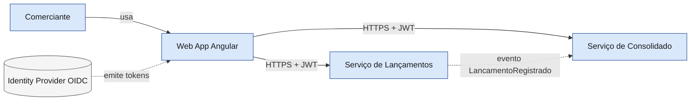
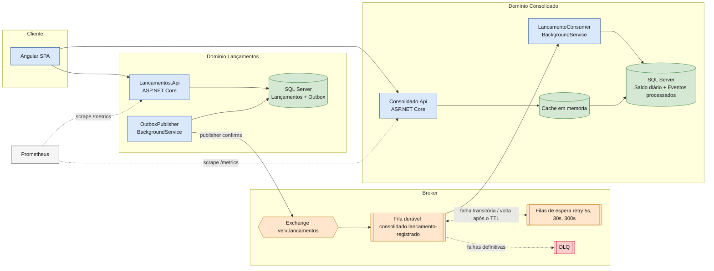
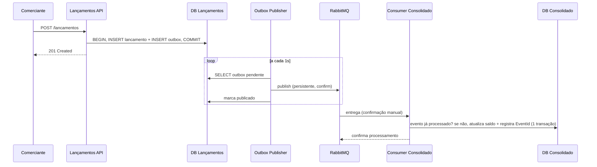
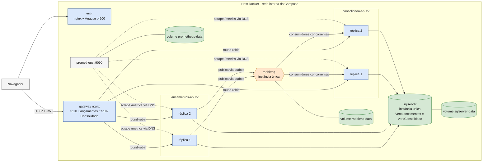

# Desenho da solução

Este documento descreve a arquitetura alvo para atender aos requisitos de [001-requisitos.md](001-requisitos.md), nos domínios definidos em [002-dominios.md](002-dominios.md).

## 1. Diagramas

Os diagramas das seções 2, 3, 4 e 6 estão em Mermaid neste documento e também em uma versão editável no draw.io:

[diagramas/arquitetura-alvo.drawio](diagramas/arquitetura-alvo.drawio)

| Página no draw.io | Diagrama | Seção |
|---|---|---|
| 1 | Contexto (C4 nível 1) | 2 |
| 2 | Containers (C4 nível 2) | 3 |
| 3 | Fluxo de escrita (sequência) | 4 |
| 4 | Implantação (Docker Compose) | 6 |

Para abrir o arquivo, use app.diagrams.net → Arquivo → Abrir, ou a extensão draw.io do VS Code. Ao alterar um diagrama, mantenha as duas versões iguais.

**Padrão visual** (o mesmo no Mermaid e no draw.io):

| Cor | Significado |
|---|---|
| Azul | Serviço ou aplicação |
| Verde | Banco de dados e cache |
| Laranja | Mensageria (exchange e filas) |
| Cinza | Sistema externo ou de apoio (IdP, Prometheus) |
| Vermelho | Falha (DLQ) |

Linha contínua é chamada síncrona; linha tracejada é evento, apoio ou falha.

## 2. Visão de contexto (C4 – nível 1)

## 3. Containers (C4 – nível 2)

Os dois domínios têm bancos de dados distintos e não se acessam diretamente. Com o broker (arquitetura alvo), a única integração é o evento `LancamentoRegistrado`, definido em `Verx.Contracts`, sem chamada síncrona entre os serviços. No modo local sem Docker (HTTP) o evento vai por `POST /internal/eventos` e o Consolidado confere o evento no Lançamentos (`GET /internal/eventos/{id}`) antes de aplicá-lo; essa conferência não existe com o broker. Mensagens que falham de forma transitória passam pelas filas de espera; as definitivas vão à DLQ, de onde um administrador as reprocessa (`POST /admin/dlq/reprocessar`).

## 4. Fluxo de escrita (comando)

O `201` não depende do broker nem do Consolidado: se qualquer um estiver fora, o evento permanece no outbox ou na fila e é aplicado quando o componente voltar.

## 5. Fluxo de leitura (consulta)
`GET /consolidado/{data}` → cache em memória (TTL configurável, padrão 10 s, invalidado quando o evento do dia é processado) → em *miss*, leitura por chave primária em `SaldoDiario`. Custo por requisição: uma busca por chave primária ou um acerto de cache.

## 6. Implantação (Docker Compose)

O `docker-compose.yml` entregue implanta isto (as seções 2 a 4 mostram a lógica; esta mostra onde cada peça roda):

- As APIs não publicam portas; o gateway é a única entrada e as réplicas escalam com `docker compose up -d --scale lancamentos-api=N`.
- Os volumes nomeados preservam os dados em `docker compose down`.
- **Limite:** SQL Server e RabbitMQ são instância única no Compose. A alta disponibilidade deles (SQL zona-redundante, RabbitMQ em cluster/quorum ou Service Bus) pertence ao ambiente de produção.
- O modo sem Docker (`run\run.cmd`) não usa este desenho: roda as duas APIs e o Angular em processos locais com SQLite e HTTP no lugar do broker.
