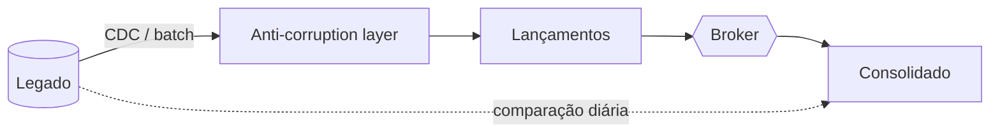

# Transição do legado

Este documento descreve como migrar do cenário atual (legado) para a solução definida em [003-desenho-da-solucao.md](003-desenho-da-solucao.md).

## 1. Cenário assumido
O comerciante usa hoje uma planilha ou um sistema legado, com os lançamentos em um banco único e o relatório gerado por consulta direta.

## 2. Estratégia
Abordagem *Strangler Fig*: a solução nova assume as funcionalidades aos poucos, enquanto o legado continua funcionando, até poder ser desligado.

## 3. Fases

| Fase | Ação | Risco / reversão |
|---|---|---|
| 0 | Mapear o legado; definir `Verx.Contracts` e a reconciliação (saldo do legado = saldo novo) | — |
| 1 | **Carga inicial:** importar o histórico para Lançamentos por endpoint ou batch; o Consolidado reconstrói os saldos a partir dos eventos (replay) | Reversível: o legado segue como fonte |
| 2 | **Execução paralela:** lançamentos gravados no legado e no novo (dual write via CDC/outbox do legado); relatório comparado automaticamente | Divergências geram alerta |
| 3 | **Virada de leitura:** o relatório passa a vir do Consolidado | Feature flag para voltar |
| 4 | **Virada de escrita:** o novo serviço vira a fonte; o legado fica somente leitura e depois é desligado | Rollback até o fim da janela |

## 4. Arquitetura de transição

O reprocessamento é seguro por causa da idempotência por `EventId`.

## 5. Impacto operacional e infraestrutura existente

| Área | Impacto | Ação |
|---|---|---|
| Financeiro / contabilidade | O fechamento do dia passa a vir do Consolidado; durante a execução paralela há duas fontes | Conciliação diária legado × novo e aceite formal do financeiro antes da virada de leitura |
| Suporte e operação | Novos componentes (broker, dois serviços, painéis e alertas) | Runbooks, plantão e treinamento; logs e correlation-id para diagnóstico (ver [007-monitoramento.md](007-monitoramento.md)) |
| Usuários (comerciantes) | Nova tela e login individual | Treinamento curto, manual e período de uso assistido |
| Banco de dados existente | O legado continua como fonte até a fase 4; a carga e o CDC geram leitura extra | Leitura em réplica ou fora do horário de pico; limite de carga; nenhuma alteração de schema no legado |
| Integrações (ERP, relatórios, BI) | Consumidores atuais do banco legado | Inventariar consumidores na fase 0; mantê-los no legado até migrarem para a API ou para um export do Consolidado |
| Infraestrutura e rede | Novos serviços na nuvem e conexão com o legado | VPN ou conexão privada, firewall e janela de mudança aprovada |
| Segurança e conformidade | Dados passam a ser tratados também na nova plataforma | Mesmas regras de LGPD e de acesso (ver [008-seguranca.md](008-seguranca.md)) |
| Janelas de virada | Risco de indisponibilidade na troca | Viradas fora do horário comercial, com plano de rollback e comunicação prévia |

Os riscos da migração estão em [009-riscos.md](009-riscos.md) (R07).
