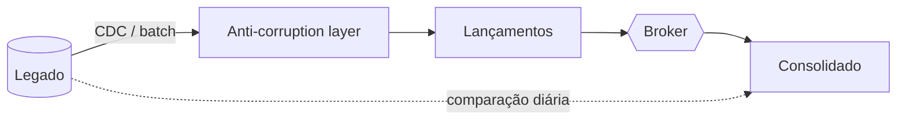

# Transição do legado

Este documento descreve como migrar do cenário atual (legado) para a solução definida em [003-desenho-da-solucao.md](003-desenho-da-solucao.md).

## 1. Cenário assumido
O comerciante usa hoje uma planilha ou um sistema legado, com os lançamentos em um banco único e o relatório gerado por consulta direta.

## 2. Estratégia
Abordagem *Strangler Fig*: a solução nova assume as funcionalidades aos poucos, enquanto o legado continua funcionando, até poder ser desligado.

## 3. Fases

| Fase | Ação | Risco / reversão |
|---|---|---|
| 0 | Mapear o legado; definir `Verx.Contracts` e a reconciliação (saldo do legado = saldo novo) | — |
| 1 | **Carga inicial:** importar o histórico para Lançamentos por endpoint ou batch; o Consolidado reconstrói os saldos a partir dos eventos (replay) | Reversível: o legado segue como fonte |
| 2 | **Execução paralela:** lançamentos gravados no legado e no novo (dual write via CDC/outbox do legado); relatório comparado automaticamente | Divergências geram alerta |
| 3 | **Virada de leitura:** o relatório passa a vir do Consolidado | Feature flag para voltar |
| 4 | **Virada de escrita:** o novo serviço vira a fonte; o legado fica somente leitura e depois é desligado | Rollback até o fim da janela |

## 4. Arquitetura de transição

O reprocessamento é seguro por causa da idempotência por `EventId`.
