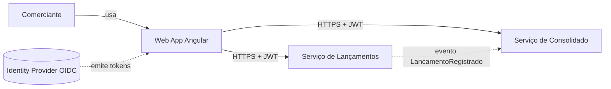
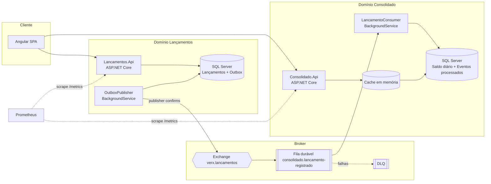
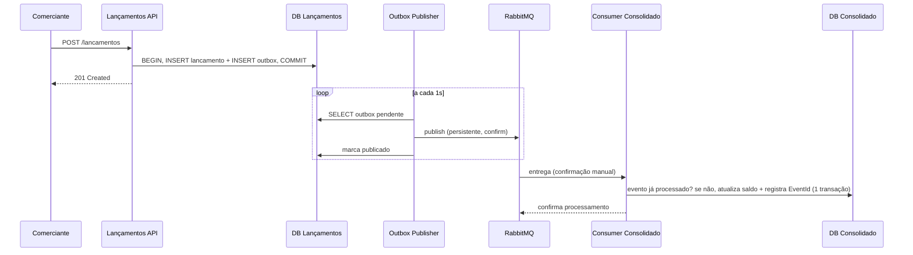

# 2. Arquitetura alvo

## 2.1 Visão de contexto (C4 – nível 1)

## 2.2 Containers (C4 – nível 2)

## 2.3 Fluxo de escrita (comando)

O `201` não depende do broker nem do Consolidado: se qualquer um estiver fora, o evento permanece no outbox/na fila e é aplicado quando o componente voltar.

## 2.4 Fluxo de leitura (consulta)
`GET /consolidado/{data}` → cache em memória (TTL configurável, padrão 10 s; invalidado quando o evento do dia é processado) → em *miss*, leitura por PK em `SaldoDiario`. Custo por requisição: uma busca por chave primária ou um acerto de cache.

## 2.5 Como os RNFs são atendidos

**Lançamentos disponível com Consolidado fora (RNF01).** Não há dependência síncrona. Cenários:
| Falha | Efeito em Lançamentos | Recuperação |
|---|---|---|
| Consolidado (API ou consumer) fora | Nenhum | Fila durável acumula; ao voltar, consome o backlog |
| RabbitMQ fora | Nenhum (grava no banco); publisher reconecta | Outbox entrega depois (at-least-once) |
| BD do Consolidado fora | Nenhum | Consumer rejeita a mensagem → retentativa → DLQ; reprocessável |

**50 req/s com ≤ 5% de perda (RNF02).** 50 req/s sobre uma leitura por PK é carga baixa para uma instância; com cache, a maioria das requisições nem toca o banco. Para folga: ≥ 2 réplicas atrás de balanceador, *readiness probe* e *autoscaling* por CPU/RPS. Validação: `tests/load/consolidado.js` (k6) com limiar `http_req_failed < 5%`.

**Corretude do saldo.** At-least-once exige idempotência: `EventoProcessado(EventId)` é gravado na mesma transação do saldo. Concorrência entre consumidores é tratada com *optimistic concurrency* (`Versao`) e retentativa.

## 2.6 Padrão arquitetural e trade-offs
Dois serviços (microsserviços enxutos) orientados a eventos, com CQRS leve (modelo de escrita ≠ modelo de leitura pré-agregado). Um monolito seria mais simples, mas não isola falhas (RNF01) nem escala leitura e escrita de forma independente. Detalhes nos ADRs em [`adr/`](adr/).

## 2.7 Mapeamento para nuvem (alvo)
| Local (docker-compose) | Alvo produção (ex.: Azure; equivalente em AWS) |
|---|---|
| Containers .NET | Azure Container Apps / AKS (≥ 2 réplicas, autoscale) |
| RabbitMQ | Azure Service Bus (ou RabbitMQ gerenciado/cluster quorum) |
| SQL Server | Azure SQL (um banco por serviço, zona redundante) |
| Cache em memória | Azure Cache for Redis (cache compartilhado e invalidação central) |
| JWT local | Microsoft Entra ID / Keycloak (OIDC) |
| Prometheus | Azure Monitor / Managed Prometheus + Grafana; OpenTelemetry |
| nginx (SPA) | Static Web Apps / CDN |
| — | API Gateway (APIM / YARP) com rate limiting e WAF |
