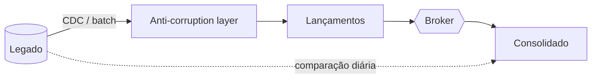

# 3. Arquitetura de transição e estimativa de custos

## 3.1 Transição (migração de legado)
Cenário assumido: o comerciante hoje usa planilha/sistema legado com lançamentos em banco único e relatório por consulta direta.

Abordagem *Strangler Fig* em fases:

| Fase | Ação | Risco / reversão |
|---|---|---|
| 0 | Mapear legado; definir `Verx.Contracts` e reconciliação (saldo legado = saldo novo) | — |
| 1 | **Carga inicial**: importar histórico para Lançamentos via endpoint/batch; Consolidado reconstrói saldos a partir dos eventos (replay) | Reversível: legado segue como fonte |
| 2 | **Execução paralela**: lançamentos gravados no legado e no novo (dual write via CDC/outbox do legado); relatório comparado automaticamente | Divergências geram alerta |
| 3 | **Virada de leitura**: relatório passa a vir do Consolidado | Feature flag para voltar |
| 4 | **Virada de escrita**: novo serviço vira fonte; legado somente leitura e depois desligado | Rollback até o fim da janela |

O reprocessamento é seguro por causa da idempotência por `EventId`.

## 3.2 Estimativa de custos (mensal, ordem de grandeza)
> Valores aproximados em USD, região Brasil/EUA, preços de lista, sem desconto/reserva. Devem ser revalidados na calculadora do provedor antes de qualquer decisão.

| Item | Dimensionamento | Custo estimado |
|---|---|---|
| Containers (2 APIs × 2 réplicas, 0,5 vCPU/1 GiB) | Container Apps | ~ US$ 60–120 |
| Azure SQL (2 bancos, General Purpose, 2 vCore serverless/pausa) | zona redundante opcional | ~ US$ 150–400 |
| Service Bus Standard | até 13 M ops/mês | ~ US$ 10–20 |
| Redis (Basic/Standard C0–C1) | cache compartilhado | ~ US$ 16–55 |
| Observabilidade (Monitor/Log Analytics, Grafana gerenciado) | ~ 10 GB/dia | ~ US$ 50–150 |
| API Gateway/WAF + CDN/Static Web | | ~ US$ 30–150 |
| Entra ID | tier gratuito/P1 conforme recursos | US$ 0–6/usuário |
| **Total aproximado** | ambiente produtivo pequeno | **~ US$ 300–900/mês** |

**Licenças:** a stack é majoritariamente open source (.NET, Angular, RabbitMQ, Prometheus). SQL Server em PaaS embute a licença; no `docker-compose` usa-se a edição Developer (somente desenvolvimento). Alternativa de redução: PostgreSQL gerenciado (sem licença de SQL Server).

**Dev/homologação:** ~ 30–40% do custo de produção com réplica única e bancos *serverless*.
